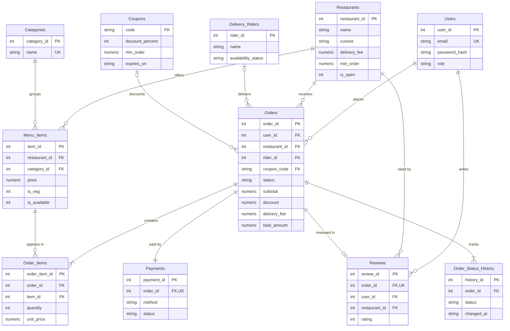

# ER Diagram (renders on GitHub, VS Code, or mermaid.live)

## Design notes
- **3NF**: every non-key column depends only on its table's key. `Order_Items.unit_price` is deliberately copied from `Menu_Items.price` so past orders keep the price they were bought at.
- **Triggers** write `Order_Status_History` and flip rider availability, so the rules hold no matter which client touches the database.
- **Constraints**: CHECKs on every status/enum/price/rating, FOREIGN KEYs everywhere (enabled per connection), UNIQUE email, one payment and one review per order.
